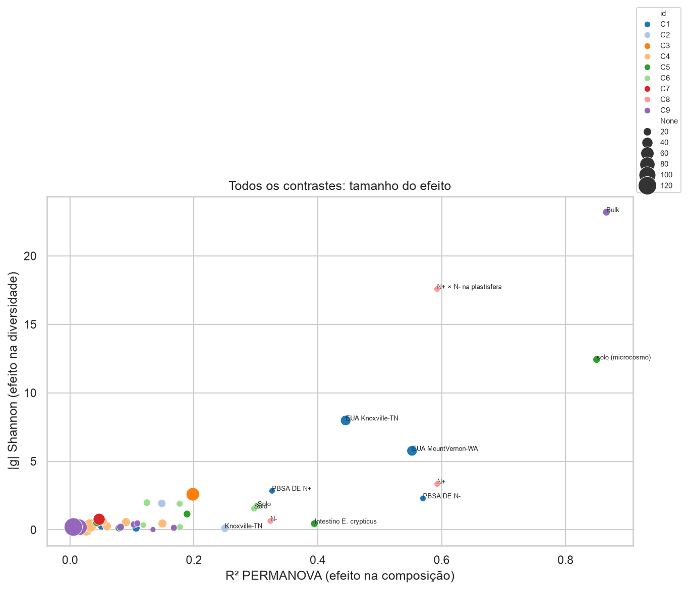

# Top 10 comparações com potencial de artigo — `conjunto_alex` (metadados corrigidos)

**Base:** 553 amostras de 16S, 9 BioProjects, metadados corrigidos pelo NCBI/ENA (`CORRECOES_METADADOS.md`).
**Análise:** [`analise_v2_comparacoes.ipynb`](analise_v2_comparacoes.ipynb). Tabelas em `tabelas/v2/`, figuras em `figuras/v2/`.
Todos os números vêm de: PERMANOVA (Bray–Curtis, ASV rarefeito a 12.000 leituras), riqueza/Shannon, e abundância diferencial de gêneros (CLR + Mann‑Whitney, FDR 5 %).

## Como foi feito o ranking

Cada comparação recebeu uma nota de 0 a 3 em quatro critérios:

| Critério | 0 | 3 |
|---|---|---|
| **Efeito** | R² < 0,05 e nenhum gênero diferencial | R² > 0,3, mudança grande de diversidade e centenas de gêneros diferenciais |
| **Replicação** | 1 estudo, n ≤ 5 por grupo | ≥ 3 desenhos/países independentes, com o mesmo resultado |
| **Desenho** | confundido (fração, tempo e estudo mudam juntos) | fatorial balanceado, mesmo local e mesma época |
| **Novidade** | já é o resultado principal do artigo original | pouco explorado na literatura de solo; só possível integrando estudos |

A nota de novidade é minha avaliação, feita com uma busca rápida na literatura. **Ela deve ser confirmada numa revisão bibliográfica** antes de escolher o tema.

---

## Ranking

| # | Comparação | Efeito | Repl. | Desenho | Novid. | **Total** |
|---|---|:-:|:-:|:-:|:-:|:-:|
| 1 | Núcleo da plastisfera do solo entre estudos | 3 | 3 | 2 | 2 | **10** |
| 2 | Perda de nitrificantes na plastisfera | 3 | 2 | 2 | 3 | **10** |
| 3 | Patescibacteria (CPR) enriquecidas na plastisfera | 3 | 1 | 2 | 3 | **9** |
| 4 | O plástico muda menos a rizosfera que o solo bulk | 2 | 2 | 2 | 2 | **8** |
| 5 | Cultura de enriquecimento em laboratório × plastisfera de campo | 3 | 1 | 2 | 2 | **8** |
| 6 | O polímero define a plastisfera (PE × biodegradáveis) | 2 | 2 | 3 | 1 | **8** |
| 7 | PLA × PET e glifosato: solo × intestino de *E. crypticus* | 3 | 1 | 3 | 1 | **8** |
| 8 | PBSA × adubação nitrogenada | 3 | 1 | 3 | 1 | **8** |
| 9 | Mulch de papel × plástico × sem mulch, 2 anos e 2 sítios | 1 | 2 | 3 | 2 | **8** |
| 10 | Biodegradável × convencional no solo: síntese entre estudos | 1 | 3 | 1 | 2 | **7** |
| — | *Menções:* direção do efeito campo × microcosmo (7); fotoenvelhecimento de MP (6) | | | | | |

---

## 1. Núcleo da plastisfera do solo entre estudos — **10/12**

**Pergunta:** existe uma comunidade "típica de plastisfera" que se repete em diferentes solos, polímeros e países?

| Desenho | n (plast./solo) | R² | Riqueza | Gêneros diferenciais |
|---|---|---|---|---|
| EUA Knoxville‑TN (5 filmes, campo) | 20 / 15 | **0,45** | −69 % | 362 de 501 |
| EUA Mount Vernon‑WA (5 filmes, campo) | 20 / 15 | **0,55** | −60 % | 376 de 484 |
| Alemanha, PBSA, sem N | 5 / 5 | **0,57** | −38 % | 147 de 396 |
| Alemanha, PBSA, com N | 5 / 5 | **0,33** | −86 % | 47 de 217 |
| Alpes (PRJNA630025) | 11 / 7 | 0,11 (p = 0,09) | +3 % | 0 |
| Ártico (PRJNA630025) | 8 / 10 | 0,05 (p = 0,39) | −4 % | 0 |

- **Núcleo enriquecido** (em ≥ 3 desenhos; ΔCLR > 1; q < 0,05): *Stenotrophomonas*, *Rhodococcus*, *Pseudomonas*, *Dyadobacter*, *Neorhizobium*, *Pseudorhodoferax*, *Roseomonas*, *Brevundimonas*, *Bosea*, *Caulobacter*, *Aeromicrobium*, *Flavobacterium*, Alcaligenaceae, Microbacteriaceae (17 gêneros). São copiotróficos formadores de biofilme, e vários deles são degradadores de plástico descritos.
- **Núcleo depletado:** 52 gêneros, quase todos oligotróficos típicos de solo: *Ca.* Udaeobacter, RB41, Vicinamibacteraceae, Rokubacteriales, Latescibacterota, Gemmatimonadota.
- **Por que é forte:** o efeito é grande e se repete em 2 países, 6 polímeros, campo e mesocosmo. Para o solo, uma reanálise padronizada de dados brutos entre estudos é mais rara que para o ambiente marinho, onde já existe uma meta-análise com cerca de 1.200 amostras.
- **Ressalva:** PRJNA630025 não mostra efeito, e na PCoA as duas frações aparecem misturadas. Como a fração desse projeto não pôde ser verificada no NCBI, é preciso **confirmar a anotação no suplemento de Rüthi et al. 2020** antes de publicar. Se a anotação estiver certa, o resultado vira uma discussão interessante: em solos frios, a plastisfera não se diferencia em 8 semanas.
- **Título possível:** *"A conserved soil plastisphere across polymers and continents: cross-study reanalysis reveals loss of oligotrophs and nitrifiers."*
- Figuras: `figuras/v2/C1_pcoa.png`. Tabela: `tabelas/v2/C1_nucleo_plastisfera.csv`.

## 2. Perda de nitrificantes na plastisfera — **10/12**

**Pergunta:** a superfície do plástico exclui a guilda de nitrificantes? Em caso afirmativo, isso tem consequências para o ciclo do N.

- A soma de *Nitrospira*, *Nitrosospira*, MND1, Ellin6067 e Nitrosomonadaceae tem mediana de **1,2 % no solo, 2,1 % na rizosfera e 0,02 % na plastisfera**.
- ΔCLR entre plastisfera e solo, por desenho:

  | Desenho | *Nitrospira* | *Nitrosospira* | MND1 | Ellin6067 |
  |---|---|---|---|---|
  | TN | −4,1 | −2,3 | −4,6 | −4,5 |
  | WA | −3,7 | −2,6 | −3,8 | −2,2 |
  | PBSA sem N | −3,8 | −2,1 | −5,3 | −4,5 |
  | PBSA com N | −1,1 | −0,4 | −1,4 | −0,5 |

- **No solo bulk com plástico, não há efeito sobre os nitrificantes** (meta-análise com 6 estratos: g = 0,32, p = 0,47). O efeito é **local, restrito à superfície do plástico**.
- A literatura recente descreve **enriquecimento de desnitrificantes** na plastisfera, incluindo contribuição para N₂O (PubMed 41167168, 2025). A **perda de nitrificantes** complementa esse quadro: nitrificação menor e desnitrificação maior formam um *hotspot* de perda de N.
- **Fraqueza:** 16S não mede função. Seria preciso confirmar com qPCR de *amoA*/*nxrB* ou com PICRUSt2/FAPROTAX (predição mais fraca).
- Pode ser o artigo principal ou um eixo forte do artigo 1.

## 3. Patescibacteria (CPR) enriquecidas na plastisfera — **9/12**

- Nos EUA, a plastisfera tem **20 % (TN) e 12 % (WA) de Patescibacteria**, contra 2,7–3,2 % no solo (p < 0,001). O grupo dominante é **Saccharimonadia**, com 11 % na plastisfera contra 1,6 % no solo.
- Nas **culturas de enriquecimento, as Patescibacteria desaparecem** (0 %). Isso é coerente com o modo de vida de episimbiontes obrigatórios, que dependem de hospedeiros presentes no biofilme natural.
- Não aparece na plastisfera do PBSA (Alemanha). Em PRJNA630025 os valores são altos nas duas frações, o que é mais um indício de anotação duvidosa.
- **Novidade:** na busca rápida, não encontrei trabalhos destacando CPR na plastisfera do solo. É um bom "achado surpreendente" para a discussão ou para uma nota curta.
- **Fraqueza:** vem de um único experimento (2 sítios). Precisa de mais estudos para generalizar.

## 4. O plástico muda menos a rizosfera que o solo bulk — **8/12**

- **Milho (PRJNA1054347):** no solo bulk, PE e PBAT têm R² de 0,30 e cerca de 85–90 gêneros diferenciais. Na rizosfera, o R² cai para 0,18 e **nenhum gênero** difere. A interação fração × polímero é significativa (p = 0,015).
- **Duna (PRJEB59875):** em *Thinopyrum*, a sacola tem R² = 0,12 (p = 0,006). Em *Sporobolus* não há efeito (p = 0,31, n = 5).
- Nos dois estudos de campo, o plástico **aumentou** o Shannon (g ≈ +1,7 no milho e +2,0 na duna).
- **Hipótese para artigo:** a planta "tampona" o efeito do plástico. Isso é relevante para mulch agrícola.
- **Fraqueza:** são 2 estudos (China e Itália) com n de 5–6 por grupo.

## 5. Cultura de enriquecimento em laboratório × plastisfera de campo — **8/12**

- São **46 culturas de enriquecimento** (3 e 6 semanas) comparadas com 16 amostras de plastisfera de campo dos mesmos filmes em Knoxville. Resultado: R² = 0,20, riqueza −78 %, 131 gêneros diferenciais.
- O enriquecimento seleciona *Afipia*, *Sphingopyxis*, *Camelimonas*, *Rhodanobacter*, *Nocardia*, *Mesorhizobium*, *Cupriavidus*, *Acinetobacter*, *Microbacterium* e *Gordonia*. Esses gêneros são **raros no campo**. Já os nitrificantes e as Patescibacteria somem.
- O tempo de incubação (3 × 6 semanas) não muda a comunidade (R² = 0,01). O polímero muda (R² = 0,22).
- **Mensagem:** degradadores isolados em laboratório não representam o que coloniza o plástico no campo. Isso tem implicação metodológica para quem busca degradadores.
- **Fraqueza:** um único estudo, e laboratório × campo vem confundido com a data de coleta.

## 6. O polímero define a plastisfera — **8/12**

- Na plastisfera de campo (PRJNA631499), com 5 filmes e 2 sítios: o sítio explica 35 % e **o polímero 16 %** (p = 0,001, permutação dentro do sítio).
- PE × biodegradáveis: R² de 0,25 (TN) e 0,15 (WA). A riqueza é **44 % maior na plastisfera do PE** nos dois sítios.
- **9 gêneros** diferem nos dois sítios, sempre mais abundantes nos biodegradáveis: *Methylobacterium*, *Deinococcus*, *Klenkia*, *Nakamurella*, *Marmoricola*, Oxalobacteraceae e Sphingomonadaceae, entre outros.
- **Fraqueza:** é um resultado já explorado no artigo original do experimento (Bandopadhyay et al.). Serve melhor como seção de um artigo maior (o 1).

## 7. PLA × PET e glifosato: solo e intestino de *Enchytraeus crypticus* — **8/12**

- **Solo:** o polímero explica **R² = 0,83**. PLA × controle tem R² = 0,85 e riqueza −68 %. O solo com PLA fica dominado por *Lysobacter* (39 %), Xanthomonadaceae (19 %) e *Cupriavidus* (12 %). O PET tem efeito bem menor (R² = 0,19).
- **Intestino:** o polímero explica R² = 0,42, com interação polímero × glifosato (R² = 0,11, p = 0,025). No intestino, o PLA **aumenta** a riqueza (+32 %), com dominância de Comamonadaceae e *Pseudomonas*.
- **O glifosato sozinho quase não tem efeito** (R² 0,02–0,04, p > 0,05).
- **Fraqueza:** é o resultado principal do artigo original (J. Hazard. Mater. 2025), com n = 4 por célula. Tem pouca novidade isolado, mas **é um ótimo caso extremo** para o tópico 10: MP biodegradável particulado em microcosmo.

## 8. PBSA × adubação nitrogenada — **8/12**

- No solo: N (R² 0,29), PBSA (0,19) e **interação N × PBSA (0,17, p = 0,001)**. O efeito do PBSA no solo **dobra com N**: R² 0,32 sem N contra 0,59 com N, e riqueza −64 % com N.
- Na plastisfera, o N reduz a riqueza em 91 %. A comunidade fica dominada por Alcaligenaceae (47 %) e *Stenotrophomonas* (18 %).
- **Mensagem:** a adubação nitrogenada potencializa a seleção causada pelo plástico biodegradável. Isso é relevante para o manejo agrícola.
- **Fraqueza:** um único estudo com n = 5, e o resultado já está no artigo original.

## 9. Mulch de papel × plástico × sem mulch, 2 anos e 2 sítios — **8/12**

- Com os metadados **corrigidos**, o polímero passou a ter efeito no solo (antes era nulo): R² de 0,135 em TN e 0,090 em WA, p = 0,001, com permutação dentro da coleta.
- **O mulch de papel altera mais o solo que os plásticos:** papel × sem mulch tem R² = 0,15 e 24 gêneros diferenciais em TN. Biodegradáveis × sem mulch têm R² 0,03 e 0–4 gêneros; PE × sem mulch tem R² 0,06–0,09 e nenhum gênero.
- O efeito é **dependente de sítio e estação**: é significativo só em Mount Vernon‑WA e só nas coletas de setembro (2015‑09 p = 0,007; 2016‑09 p = 0,005).
- **Mensagem:** mulches biodegradáveis têm impacto no solo semelhante ao do PE, e menor que o do papel. Isso é relevante para regulamentação, e o desenho de campo é muito bom (parcelas casualizadas).
- **Fraqueza:** o efeito é pequeno, e o estudo original provavelmente já discutiu a sazonalidade.

## 10. Biodegradável × convencional no solo: síntese entre estudos — **7/12**

- Comparação direta biodegradável × não biodegradável dentro de 8 estratos: **g de Shannon = 0,00 (p = 0,996, I² = 79 %)**. Só um estrato tem efeito grande: PLA × PET em microcosmo (PRJNA1155845).
- Contra o controle, no modelo misto (8 estratos): os biodegradáveis reduzem o Shannon (−0,33 DP, **p = 0,0001**) e a equitabilidade (p = 0,0004). Os não biodegradáveis não reduzem (p = 0,07).
- Poucos gêneros respondem de forma consistente ao plástico no solo bulk: 11 de 538. Entre eles, perdem abundância Ellin6055, AKYG587, *Skermanella*, *Solirubrobacter*, FFCH7168 e Subgroup_25.
- **Por que importa:** responde diretamente à pergunta regulatória "o biodegradável é mais seguro para o microbioma do solo?". A resposta é: **nem mais nem menos no geral; depende do formato, da dose e do tipo de experimento**.
- **Fraqueza:** grande heterogeneidade e apenas 8 estratos. Os moderadores (formato, experimento) não têm poder estatístico suficiente (ver menção abaixo).

### Menções honrosas
- **Direção do efeito campo × microcosmo:** em estudos *ex situ* (microcosmo), o plástico reduz o Shannon (g mediano −0,70); *in situ* (campo), aumenta (+0,78). Com k = 8 não é significativo, mas é uma hipótese interessante. Se o grupo incluir mais BioProjects, pode virar o eixo do artigo 10.
- **Fotoenvelhecimento de MP (PRJNA1021161):** só o PE fotoenvelhecido por 5 dias difere do virgem (R² 0,05, p = 0,03). PE e PLA virgens não diferem do controle. O efeito é fraco.

---

## Recomendação: 2 artigos

**Artigo A — "A plastisfera do solo entre estudos"** (tópicos 1 + 2 + 3, com 5 e 6 como seções)
- Esse é o conjunto mais forte: efeito grande, replicado e com dois ângulos novos (nitrificantes e CPR).
- É preciso: (i) confirmar a anotação de PRJNA630025; (ii) incluir mais BioProjects com plastisfera × bulk (PRJNA853344 e PRJNA1079663 já estão na planilha); (iii) inferência funcional (PICRUSt2/FAPROTAX) ou dados de *amoA*.

**Artigo B — "Biodegradável × convencional no solo: o contexto importa"** (tópicos 10 + 9 + 4 + 7 + 8)
- Tem relevância aplicada e regulatória. A mensagem é: o efeito depende de formato, dose, presença de planta e manejo (N), não da biodegradabilidade em si.
- É preciso: mais estudos com controle para aumentar k e ter poder para os moderadores; ANCOM‑BC2 ou MaAsLin2 como método confirmatório.

## Ressalvas gerais
- Hedges g muito altos (|g| > 5) vêm de grupos com variância interna minúscula e n pequeno. Para comunicar, prefira R² e a % de riqueza.
- Vários contrastes têm PERMDISP significativo (`p_disp` < 0,05). Parte do R² reflete diferença de dispersão, não só de centróide.
- O "núcleo" usa rótulos de gênero do SILVA 138. Nomes como MND1, RB41 e AKYG587 são clados não cultivados.
- Tudo parte dos metadados corrigidos. Se a planilha online mudar, rode `gerar_correcoes.py` → `preparar_metadados.py` → os dois notebooks.
